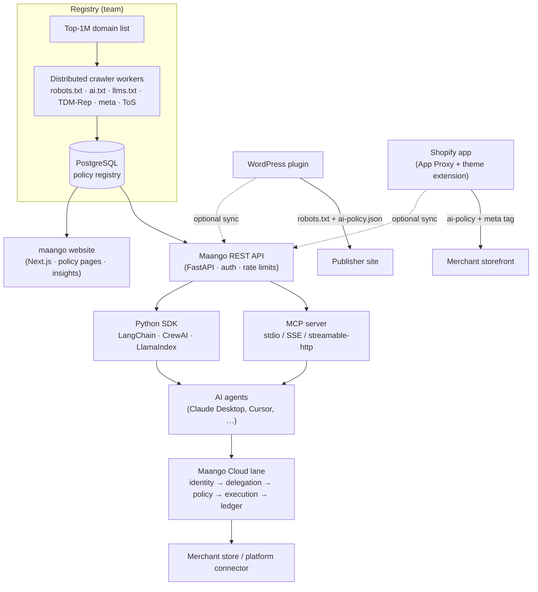

# Maango: the AI policy registry for the web

**A registry of what websites allow AI agents to do, covering 1M+ domains, plus the integrations that let publishers declare their policies and let agents check them before they act.**

> 🔒 **The source code is private.** This repo is a showcase of the project's purpose, architecture, and my role. **A demo is available on request.**
>
> Maango is co-built with a small team (core platform led by [@7mehul](https://github.com/7mehul)). I built the agent-facing and publisher-facing integrations and contributed to the platform.

---

## What it does

AI crawlers and agents need to know whether a site permits training, search indexing, or use as model input, and the answer is scattered across robots.txt, ai.txt, llms.txt, TDM-Rep, meta tags, and Terms of Service. Maango:

- **Crawls and normalizes** AI-policy signals across **1M+ domains** into one registry, aggregating 8 AI-policy standards.
- **Answers questions** like *"Can my agent use this site for training?"* through a REST API, an MCP server, and a Python SDK.
- **Gives publishers tools** to declare a policy (WordPress plugin, Shopify app) and sync it to the registry.
- **Maango Cloud** extends this to commerce with a governed lane between AI agents and a merchant's store. It verifies who the agent is, applies the merchant's rules, and records every call in a tamper-evident ledger.

## Key features

- **Domain policy lookup, search, and comparison**, including stance, per-bot rules, per-use-case permissions, and conflicts between signals (for example, robots.txt vs. ToS).
- **One-call permission checks for agents.** `check_permission` returns allowed or denied, plus a reason code (`compliant`, `action_blocked`, `bot_blocked`, `stance_blocks_all`, `no_policy`, …) and an explanation.
- **Policy change history** through changelog endpoints and webhook subscriptions.
- **Publisher plugins** that generate robots.txt rules and a machine-readable `/.well-known/ai-policy.json`, with per-use-case controls for training, search, and inference.
- **Agent-framework SDK** with sync and async clients, retries, and ready-made tools for LangChain, CrewAI, and LlamaIndex.
- **Governed agent commerce (Maango Cloud):**
  - Agent identity via RFC 9421 HTTP Message Signatures and Web Bot Auth
  - OAuth 2.1 delegation
  - Merchant policies: caps, scopes, and human approval
  - A quote-then-commit flow
  - A hash-chained, auditable ledger

## Architecture

## Tech stack

| Area | Tech |
|---|---|
| Data / crawl | Python, asyncio/aiohttp, asyncpg, PostgreSQL (Supabase), multi-node workers |
| API / platform | Python, FastAPI, Pydantic, Docker; SQLite-backed control plane for Maango Cloud |
| Agent integrations | Model Context Protocol (MCP) SDK, Python SDK (httpx + Pydantic, sync/async), LangChain, CrewAI, LlamaIndex |
| Publisher integrations | PHP (WordPress plugin, multisite, i18n), TypeScript / Remix + Polaris (Shopify app), Prisma, Postgres, Liquid theme extension |
| Web | Next.js, TypeScript, Tailwind CSS |
| Security / standards | RFC 9421 HTTP signatures (Ed25519), Web Bot Auth, OAuth 2.1 + PKCE, hash-chained audit ledger |

## My role

Maango is a team project. My contributions:

- **I built these four repos myself (all commits are mine):**
  - **Maango MCP server:** 7 tools, including the `check_permission` decision logic with reason codes, local and remote transports, tests, Docker, and deploy scripts.
  - **Python SDK:** sync and async clients with retries, typed models, and LangChain, CrewAI, and LlamaIndex tool integrations, with tests.
  - **WordPress plugin:** stance selector, robots.txt injection, the `/.well-known/ai-policy.json` endpoint, registry sync, multisite support, security, i18n, and accessibility hardening, plus a WordPress.org submission checklist.
  - **Shopify app:** auth, Prisma/Postgres, an App Proxy policy endpoint, a theme app extension that injects the storefront meta tag, and an App Store submission checklist.
- **Maango Cloud (shared platform):** 28 commits, mostly security and correctness hardening.
  - Hardened the OAuth consent flow (clickjacking/framing protection, no secrets in logs, bounded registration).
  - Fixed a privacy leak in public ledgers by switching published fields to an allow-list.
  - Fixed a hash-chain integrity bug.
  - Closed a race that let concurrent agents exceed daily spending caps.
  - Fixed currency minor-unit handling, built a commerce-platform connector checked against the vendor's published spec, and added merchant notifications and dashboard configuration.
- **Registry and website (feature branches):** changelog API endpoints, a webhook subscription system with a delivery worker, a changelog page, and agent-readiness work for the website.

## Demo notes

A walkthrough shows:

1. **Ask an agent.** In Claude Desktop or Cursor connected to the Maango MCP server, ask *"Can I scrape this site for training data?"* The agent gets a one-call verdict with a reason code and the policy signals behind it.
2. **Registry lookups.** Look up, search, and compare domains by AI stance, see which bots each site blocks, and inspect conflicts between signals.
3. **SDK in an agent framework.** Drop Maango tools into a LangChain or CrewAI agent so it checks permissions before fetching content.
4. **Publisher side.** Pick a stance in the WordPress plugin and watch robots.txt and `/.well-known/ai-policy.json` update. In the Shopify app, preview the storefront policy and meta tag.
5. **Maango Cloud.** An agent calls a merchant lane and its identity tier is resolved. A transactional request is held for human approval, and the hash-chained ledger is verified as intact (demo stores only, not live merchants).
